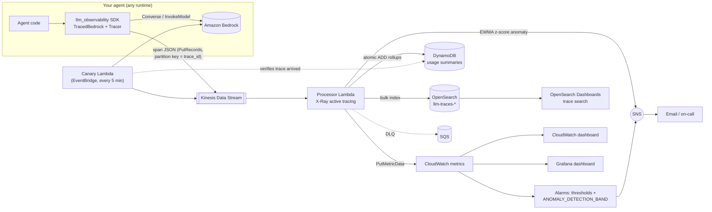

# Agent & Token Observability Platform (AWS)

A LangSmith / Langfuse-style monitoring platform for AI agents running on Amazon Bedrock.
It records every agent run as a **distributed trace** (agent → LLM calls → tool calls),
attributes **tokens and cost per user / session / agent / model**, streams everything
through **Kinesis**, stores searchable traces in **OpenSearch**, keeps usage summaries in
**DynamoDB**, publishes **CloudWatch** metrics with **statistical + ML anomaly detection**,
and alerts through **SNS**. The whole stack is **Terraform**, deployable per environment,
with **CI against a mock Bedrock endpoint**, **dashboards as code** and a **synthetic canary**.

---

## 1. Architecture



| AWS service | Role in this project | Where |
|---|---|---|
| **SDK middleware** (+ Lambda) | `TracedBedrock` wraps Bedrock calls and emits spans; `@tracer.tool()` traces tools | `sdk/llm_observability/` |
| **AWS X-Ray** | Active tracing on both Lambdas; boto3/HTTP subsegments; batches annotated with `llm_trace_id` | `infra/lambdas.tf`, `lambdas/processor/handler.py` |
| **Kinesis Data Streams** | High-volume, ordered (per trace) ingest of span events | `infra/data_stores.tf` |
| **OpenSearch Service** | Stores every span; full-text search on prompts/completions; trace drill-down | `infra/data_stores.tf`, `dashboards/opensearch/` |
| **CloudWatch** | 12 custom metrics per agent, 9 alarms, anomaly-detection bands, dashboard | `infra/monitoring.tf` |
| **Grafana** (QuickSight alternative) | Provisioned dashboard + datasource from the repo | `dashboards/grafana/` |
| **DynamoDB** | Per-user / agent / session / model daily + lifetime token & cost totals; anomaly state | `infra/data_stores.tf` |
| **SNS** | Email alerts from alarms and from the real-time anomaly detector | `infra/data_stores.tf` |
| EventBridge, SQS | Canary schedule; dead-letter queue for poison batches | `infra/lambdas.tf` |

### Data model — one span (structured log record)

```json
{
  "trace_id": "c18f6cfbeebb5879c8ac5806514ac936",   "span_id": "8d030464a67f1487",
  "parent_span_id": "2946a7be43d81f5b",             "kind": "llm",
  "name": "llm:amazon.nova-micro-v1:0",             "agent_id": "support-agent",
  "user_id": "u-li", "session_id": "s-u-li-1",      "service": "demo-app", "environment": "dev",
  "start_time_ms": 1793852913368, "latency_ms": 526.6, "status": "ok",
  "model_id": "amazon.nova-micro-v1:0", "input_tokens": 48, "output_tokens": 97,
  "total_tokens": 145, "cost_usd": 0.00001526, "stop_reason": "end_turn",
  "prompt": "system: ...\nuser: Can I get a refund on order B-77? ...",
  "completion": "...", "attributes": {"tools_offered": ["get_order_status"], "bedrock_latency_ms": 300},
  "schema_version": "1.0"
}
```

`kind` is `agent` (root span of one request), `llm`, `tool` or `custom`. The root `agent`
span carries roll-ups (`llm_calls`, `tool_calls`, `rollup_cost_usd`, ...) so one record answers
"what did this request cost?". Prompts/completions are truncated to 2,000 chars and can be
turned off entirely with `Tracer(capture_content=False)` for PII-sensitive apps.

---

## 2. Repository layout

```
sdk/llm_observability/     tracer.py   – traces, spans, context propagation (W3C traceparent)
                           bedrock.py  – TracedBedrock: Converse + InvokeModel instrumentation
                           pricing.py  – per-model token prices + cost formula
                           emitters.py – Kinesis (batched, retrying) / stdout / in-memory
lambdas/processor/         handler.py  – Kinesis → OpenSearch + DynamoDB + CloudWatch + SNS
                           anomaly.py  – streaming EWMA z-score anomaly detector
lambdas/canary/            handler.py  – synthetic end-to-end check
infra/                     Terraform for the whole stack; envs/dev.tfvars, envs/prod.tfvars
dashboards/                CloudWatch dashboard template, Grafana JSON + provisioning,
                           OpenSearch Dashboards saved objects
scripts/                   demo.py (traffic generator), show_trace.py (trace tree),
                           setup_opensearch_dashboards.py, build_lambdas.sh
tests/                     35 unit tests, mock Bedrock endpoint + botocore Stubber
.github/workflows/         ci.yml (tests, lint, terraform validate), deploy.yml (per-env deploy + smoke test)
```

---

## 3. Using the SDK

```python
import boto3
from llm_observability import Tracer, TracedBedrock, KinesisEmitter

tracer = Tracer(service="support-bot", agent_id="support-agent", environment="dev",
                emitter=KinesisEmitter("llm-obs-dev-traces"))
bedrock = TracedBedrock(boto3.client("bedrock-runtime"), tracer)   # drop-in replacement

@tracer.tool()                       # every call becomes a "tool" span
def get_order_status(order_id): ...

with tracer.agent_run(user_id="u-42", session_id="chat-7"):        # root span = one request
    resp = bedrock.converse(modelId="amazon.nova-micro-v1:0", messages=[...])
    get_order_status("A-1042")
    resp = bedrock.converse(...)
```

Calling a tool in another service? Pass `tracer.inject()` (a W3C `traceparent` header) along
and wrap the remote work in `with tracer.extract(headers):` — the remote spans join the same trace.

The SDK has **no hard dependencies** (boto3 only for the real Kinesis emitter) and
**never breaks the app**: if Kinesis is down, the error is logged and the agent carries on.

---

## 4. Deploy (≈ 25 minutes, mostly waiting for OpenSearch)

**Prerequisites:** AWS account + CLI credentials, Terraform ≥ 1.5, Python ≥ 3.10.

1. **Enable Bedrock model access** — Bedrock console → *Model access* → enable
   **Amazon Nova Micro** in `us-east-1` (or change `canary_model_id` / `LLM_OBS_MODEL`).
2. **Configure** `infra/envs/dev.tfvars`: set `alert_email` and put your public IP
   (`curl https://checkip.amazonaws.com`) in `dashboard_allowed_cidrs` as `"x.x.x.x/32"`.
3. **Install, test, deploy**
   ```bash
   make install          # boto3, pytest, ruff, the SDK in editable mode
   make test             # 35 tests, no AWS needed
   make init
   make deploy ENV=dev   # builds Lambda zips, terraform apply (OpenSearch takes ~15-20 min)
   ```
4. **Confirm the SNS subscription** in the email AWS sends you.
5. **Generate traffic**
   ```bash
   make demo                                      # 40 runs on real Bedrock (costs cents)
   LLM_OBS_STREAM=$(terraform -chdir=infra output -raw trace_stream_name) \
     python scripts/demo.py --runs 80 --spike     # baseline, then an anomaly burst → SNS email
   ```
   Use `--mock` for zero Bedrock cost (the pipeline is still fully exercised).
   Attach the `producer_policy_arn` output to whatever role runs your agents.
6. **Dashboards**
   ```bash
   make dashboards       # OpenSearch Dashboards index pattern + saved searches
   make trace            # print the latest trace as a tree in the terminal
   make outputs          # URLs for the CloudWatch dashboard, OpenSearch Dashboards, X-Ray
   ```
   Optional Grafana: `cd dashboards/grafana && docker compose up -d` → http://localhost:3000.
7. **Tear down when done** — `make destroy ENV=dev` (OpenSearch is billed hourly).

**Other environments:** `make deploy ENV=prod` uses `envs/prod.tfvars` (multi-AZ OpenSearch,
encryption at rest, 2 shards, tighter thresholds). Every resource name contains the environment,
so dev and prod coexist in one account. For real use, enable the S3 backend in `infra/main.tf`
with one state file per environment (`envs/dev.backend.hcl`).

### Rough cost (dev, us-east-1)
OpenSearch t3.small ≈ $0.036/h (≈ $0.90/day) is the main cost. One Kinesis shard ≈ $0.36/day.
Lambda, DynamoDB on-demand, CloudWatch metrics, SNS and Bedrock Nova Micro for the demo are cents.
Check current AWS pricing before deploying.

---

## 5. How each requirement is met

### Distributed tracing (spans, trace IDs)
Same model as OpenTelemetry: a 128-bit `trace_id` per agent run, a 64-bit `span_id` per unit of
work, and `parent_span_id` links that rebuild the call tree. The current span lives in a
`contextvars.ContextVar`, so nesting is automatic and safe with threads/asyncio, and
`inject()`/`extract()` propagate context across processes with the W3C `traceparent` format.
Kinesis records use `trace_id` as partition key, so all spans of one trace land on the same
shard in order. X-Ray covers the *infrastructure* path (Kinesis → Lambda → DynamoDB/OpenSearch/SNS);
the processor annotates each X-Ray segment with `llm_trace_id` to link the two views.

### Token counting and cost attribution
Tokens come from Bedrock itself (`usage` in Converse responses; `x-amzn-bedrock-*-token-count`
headers for InvokeModel), never estimated. Cost = `in/1000 × input_price + out/1000 × output_price`
with a per-model price table (`pricing.py`, overridable via `LLM_OBS_PRICING_JSON`; cross-region
inference-profile ids like `us.amazon.nova-micro-v1:0` are normalised). The processor rolls tokens,
cost, requests and errors up into DynamoDB per **user, session, agent and model**, per day and
lifetime, using atomic `ADD` updates.

DynamoDB single-table design:

| pk | sk | attributes |
|---|---|---|
| `user#u-42` / `agent#support-agent` / `session#chat-7` / `model#amazon.nova-micro-v1:0` | `day#2026-11-05` or `total` | requests, errors, llm_calls, input_tokens, output_tokens, cost_usd, tool_calls, tool_errors, latency_ms_sum (+ `last_trace_id` on agent totals) |
| `anomaly#support-agent#latency_ms` | `ewma` | count, mean, var, last_alert_ms |

Query example: `aws dynamodb query --table-name llm-obs-dev-usage --key-condition-expression "pk = :p" --expression-attribute-values '{":p":{"S":"user#u-anita"}}'`

### Anomaly detection (two layers)
1. **Real-time, statistical (processor):** an exponentially weighted moving average of mean and
   variance per agent for run latency and run cost; a run with z-score > 3 (after a 20-run warm-up)
   publishes an SNS alert within seconds and is flagged `anomaly: true` in OpenSearch. Outliers are
   down-weighted so one spike doesn't shift the baseline; a 10-minute cooldown prevents alert storms;
   canary traffic is excluded from baselines.
2. **ML (CloudWatch):** `ANOMALY_DETECTION_BAND` alarms on p90 latency and 5-minute spend. AWS trains
   these on the metric's history and they model daily/weekly seasonality, which the EWMA can't.

Plus static guard-rails: error rate > 10 %, p90 latency, hourly spend, and pipeline-health alarms
(canary failing, processor errors, Kinesis iterator age, DLQ messages).

### Structured logging for LLM apps
Every span is one flat JSON document with a fixed, versioned schema (`schema_version`): ids,
timing, status/error type/message/stack trace, model, tokens, cost, prompt, completion, stop
reason, tool name/input/output and free-form `attributes`. OpenSearch maps ids as `keyword`
(aggregations), prompts/completions as `text` (full-text search) via an index template the
processor installs automatically; indices are daily (`llm-traces-YYYY.MM.DD`) for cheap retention.

### Real-time dashboards
Latency from agent → dashboard is ~1–3 s (Kinesis batching window 1 s). CloudWatch dashboard
(`dashboards/cloudwatch-overview.json.tftpl`, deployed by Terraform): totals, cost & tokens per
agent, p50/p90/p99 latency with the anomaly band, error rates, LLM latency, requests per agent,
canary and pipeline health, alarm status. Grafana (`dashboards/grafana/`) shows the same with
environment/agent selectors. OpenSearch Dashboards gives per-trace drill-down and saved searches
(errors, anomalies, LLM calls, tool calls).

### CI/CD
* `ci.yml` — on every PR: ruff, **35 tests on Python 3.11 and 3.12** validating the SDK against a
  mock Bedrock endpoint (an in-process fake *and* a real boto3 client with botocore `Stubber`),
  processor and canary logic on fake AWS clients, `terraform validate`, dashboard JSON validation.
* `deploy.yml` — push to `main` → dev; manual dispatch → staging/prod (gate prod with GitHub
  Environment reviewers). Uses GitHub OIDC (no long-lived keys), re-runs tests, builds, plans,
  applies, then **invokes the canary as a post-deploy smoke test** and fails the job if it fails.

### Synthetic monitoring
The canary Lambda runs every 5 minutes: a 2-step agent (Bedrock call + tool call) through the real
SDK → Kinesis; it then polls DynamoDB until the processor has recorded *that* trace id. It
publishes `CanarySuccess` (0/1) and `CanaryE2ELatencyMs`; the alarm treats missing data as
failure, so even a canary that can't run pages you.

---

## 6. Design decisions & trade-offs

* **Kinesis between the app and storage** decouples agent latency from storage latency, absorbs
  bursts, and allows replay (24 h retention). The SDK batches up to 500 records per `PutRecords`
  and retries throttled entries.
* **Idempotency:** OpenSearch doc id = `span_id`, and indexing runs *first*; if it fails the whole
  batch is retried before any DynamoDB/CloudWatch counters move, so retries don't double-count.
  Batches that keep failing are bisected and finally sent to an SQS DLQ (alarmed).
* **Parallelization factor 1** keeps per-shard ordering, which makes the read-modify-write EWMA
  state safe without locks. Scale out by adding shards (one Lambda per shard).
* **Cardinality:** CloudWatch metrics are per *agent* only (users can be thousands — that would
  be expensive in CloudWatch); per-user analytics live in DynamoDB and OpenSearch.
* **Grafana instead of QuickSight:** dashboard JSON lives in git and is provisioned automatically;
  QuickSight works too (DynamoDB/OpenSearch via Athena) but is harder to keep as code.

### Comparison with LangSmith / Langfuse / Arize Phoenix
Like them: trace tree of agent runs, token/cost attribution, prompt/completion capture, per-user
analytics. Different: fully inside your AWS account (data never leaves), streaming-first
(Kinesis) with built-in alerting and anomaly detection; no prompt management, evaluation datasets
or UI for annotating traces — those would be next steps (e.g. emitting OpenTelemetry/OTLP so the
same spans can also be sent to Langfuse or Phoenix).

### Known limitations / next steps
* Streaming responses (`converse_stream`) are not wrapped yet.
* Prices are a static table — load them from a config service for production.
* OpenSearch index lifecycle (ISM delete after N days) and fine-grained access control/Cognito
  login should be enabled for production.

---

## 7. Demo checklist (screenshots for the submission)

1. `make test` / GitHub Actions run all green
2. `terraform apply` outputs
3. CloudWatch dashboard after `make demo`
4. OpenSearch Dashboards → Discover → *Agent runs* saved search; one trace filtered by `trace_id`
5. `make trace` output (trace tree in the terminal)
6. X-Ray service map (Kinesis → processor → DynamoDB / OpenSearch / SNS) and canary traces
7. DynamoDB item `user#u-anita / total` showing tokens and cost
8. SNS anomaly email after `scripts/demo.py --runs 80 --spike`, and an alarm in ALARM state
9. Canary `CanarySuccess` = 1 on the dashboard
